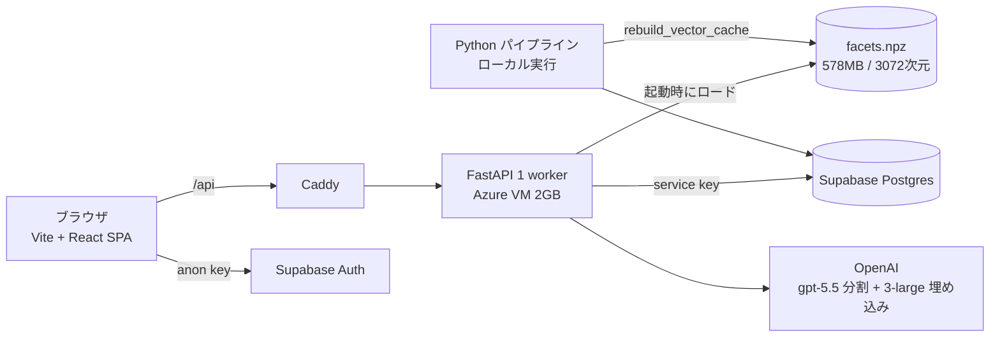
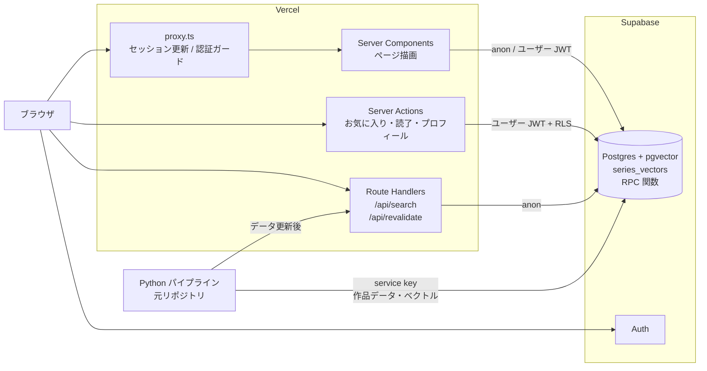
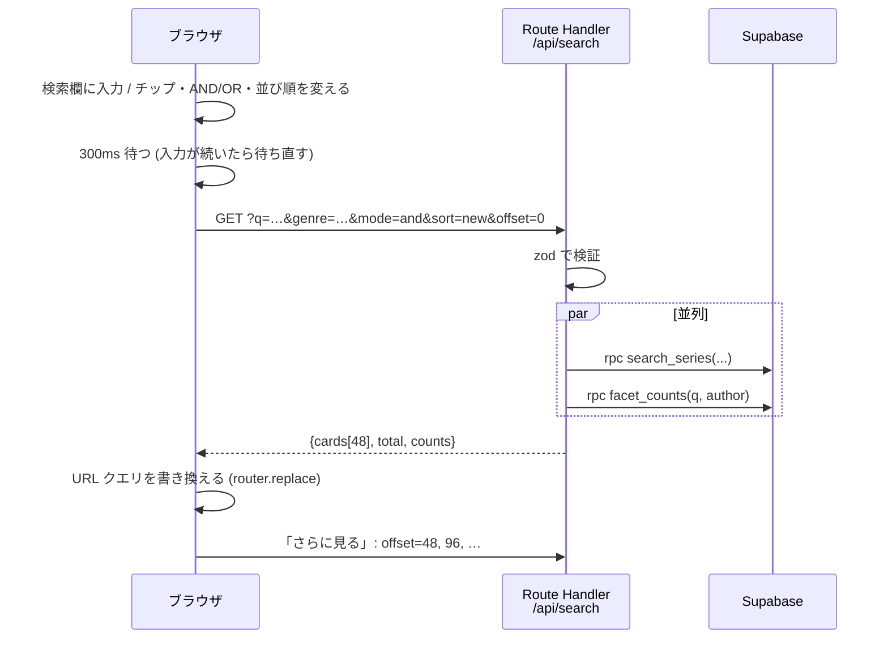

# ranobeNext アーキテクチャ設計書

- 作成日: 2026-10-13
- 前提: [requirements.md](requirements.md) (要件定義。§10 は決定済み) / [ui-design.md](ui-design.md) (画面設計。デザイン案 A に準拠)
- ステータス: ドラフト (§12 の未決事項を確定させてから実装に入る)

---

## 1. 現行アプリの整理 (As-Is)

元リポジトリ (`/Users/kei/Downloads/ライトノベル`) に正式な要件定義書はない。そのため、以下の資料とコードから現行の仕様と制約を読み取って整理した。

| 資料 | 読み取ったこと |
|---|---|
| `CLAUDE.md` / `AGENTS.md` (中身は同じ) | プロジェクトの目的、DB 構成、データパイプライン、Gemini の運用、既知の問題、開発規約 |
| `backend/deploy/README.md` | 本番構成 (Azure VM + Caddy)、メモリの制約、**API コストの警告 (レート制限とキャッシュを推奨)** |
| `backend/data/vector_cache/README.md` | npz キャッシュの扱い (DB が正本で、npz は派生データ) |
| `backend/cache/ft/facet_split_spec.md` | 6観点 (plot/cast/theme/mood/reader/review) の定義と境界のルール |
| `design/philosophy.md` | デザイン哲学「灯火索引 — Lamplit Index」 |
| `backend/app/**`, `frontend/src/**` | 機能の仕様 (requirements.md の F1〜F9 に反映済み) |

### 1.1 現行アプリの要件 (コードから読み取ったもの)

**プロダクトの目的**
- 日本のライトノベルを、タイトルではなく「**雰囲気・気分・観点**」から探せる推薦システム
- 書誌は openBD と版元ドットコム (hanmoto.com) から集める。シリーズ判定、タグ付け、6軸の雰囲気スコアは Gemini で付ける

**データの要件**
| 項目 | 内容 |
|---|---|
| 単位 | 書籍 (`openbd_test_books`、ISBN が主キー) → シリーズ (`openbd_test_series`) |
| シリーズの関係 | 親子 (`parent_series_id`)。一覧に出すのは親だけ。特装版は `attached_to_isbn` で本編に紐付ける |
| 雰囲気スコア | 6軸、0〜100、**1刻み** (5刻みや10刻みに丸めない) |
| 認知度 | `popularity_score` (長期の累計) と `momentum_score` (直近の話題、理由テキスト付き) |
| タグ | ジャンル (固定24種) / 雰囲気 / サブジャンル (サブカテゴリ7種)。公式タグと AI 生成タグを区別し、重要度 1〜3 を持つ |
| 6観点のテキストとベクトル | レビュー要約 (Grok で収集) から6観点のテキストを作り、それぞれを埋め込む。**作るのは親シリーズだけ** |
| 件数 | ベクトルのあるシリーズは 8,204件 (2026-07 時点の npz) |

**検索・推薦の要件**
- 自然言語クエリを6観点に分け、観点ごとに照合する。1つのベクトルで全体を照合すると「学園恋愛もの」のような一般的な語に結果が引っ張られるので、それを避けるため
- 「百合 / 女の子同士の恋愛 / GL」のような言い換えに強いこと (3072次元にした理由)
- ジャンルは AI が推定するが、ユーザーが UI で変えられること
- 類似作品は「ある観点で非常に近い」作品を上位に出す (二乗の項)。対象作品の一番珍しいジャンルで絞り込む

**運用・非機能の制約**
- 1検索ごとに OpenAI の費用がかかる。URL が広まると際限なく呼ばれる恐れがあるので、レート制限とキャッシュが必要 (deploy README の警告)
- Gemini 側の制約: PROHIBITED_CONTENT は回避できない。RPD (1日100K) を超えたら止める。どちらもパイプラインの話で、検索アプリには関係しない
- 破壊的な DB 操作は、dry-run と確認を先に行う。DOWN 用のマイグレーションはないので、復旧はバックアップ頼み

**デザインの要件 (`design/philosophy.md`)**
- 「灯火索引」: 読書灯の橙の光と、索引の精密さを組み合わせる
- クリーム地、角のない形、橙・琥珀・黄金の色だけを使う。文字は焦茶で、黒にはしない。余白を大きく取り、大きな見出しと小さな注記の差でリズムを作る
- ※ 今のフロント (`tailwind.config`) はピンクと水色の「ポップ」配色で、この哲学とは違う
- → **ranobeNext では、どちらも採用しない**。claude.ai Design の案 A「グリッド」(Modernist、モノトーン + 朱色1色、角丸なし) に統一する (ui-design.md §1)

### 1.2 現行の構成



問題点: 検索に必要な状態 (600MB の行列) がアプリのプロセスのメモリに乗っている。そのためサーバーレスにできず、スケールもできない。

---

## 2. 新しい構成 (To-Be)

**2026-10-15 の方針変更**: 自然言語検索 (AI 検索) は作らない。似ているシリーズとおすすめは、ベクトル専用の細いテーブル `series_vectors` に対して RPC の中でその場で計算する (§4.3)。アプリから OpenAI は呼ばない。



### 2.1 設計方針

| # | 方針 | 理由 |
|---|---|---|
| 1 | **アプリはステートレスにする**。状態はすべて Postgres に置く | Vercel で動かせて、スケールも簡単になる |
| 2 | **計算に使うデータは細いテーブルに分ける** | Supabase は Micro (共有バッファ 256MB)。使う列だけの `series_vectors` (約151MB) ならメモリに収まり、その場で計算しても間に合う |
| 3 | **検索と推薦は SQL 関数 (RPC) にまとめる** | 1往復で済み、ロジックが1か所にまとまる |
| 4 | **アプリでは service role key を使わない** | 公開データは anon + RLS の read-all で読み、ユーザーデータはユーザーの JWT + RLS で扱う。キーが漏れたときの影響を小さくする |
| 5 | **データパイプラインは元リポジトリのまま** | パイプラインの書き込み先は DB だけで、アプリとのつながりは「DB のスキーマ」と「再検証の Webhook」の2つだけにする |
| 6 | **アプリから有料の外部 API を呼ばない** | 自然言語検索をやめたので、OpenAI のキー・コスト・レート制限の仕組みが要らなくなった |

---

## 3. リポジトリ構成 (ranobeNext)

2026-10-15 にフェーズ2 (土台) を実装した時点の構成。✅ は作成済み。Next.js 16.4 の決まりに合わせて `src/` の下に置き、`middleware.ts` は `proxy.ts` (Next.js 16 で名前が変わった) にしている。

```
ranobeNext/
  src/
    app/
      layout.tsx               ✅ フォント (Archivo + Noto Sans JP)、テーマ、ヘッダー、Toaster
      page.tsx                 ✅ F1 ホーム (枠だけ。中身はフェーズ3)
      search/page.tsx          ✅ F2・F3・F6 (枠だけ。著者は ?author= で絞る)
      series/[id]/page.tsx     ✅ F5 詳細 (枠だけ)
      auth/page.tsx            ✅ F7 ログイン / 新規登録
      auth/auth-form.tsx       ✅   フォーム本体 (useActionState)
      account/page.tsx         ✅ F9 (ログイン必須。中身はフェーズ3)
      api/
        search/route.ts        #   入力に合わせた絞り込み (search_series + facet_counts を並列に呼ぶ)
        revalidate/route.ts    ✅ パイプラインからのキャッシュ無効化 (シークレット必須)
      sitemap.ts
      globals.css              ✅ デザイントークン (:root = ライト / .dark = ダーク) と @theme inline
    components/                # 表示用の部品 (中身は ui-design.md §6)
      ui/                      ✅ shadcn/ui からコピーした部品 (Modernist に合わせて書き換え済み)
      theme/                   ✅ next-themes の Provider とテーマ切替ボタン
      layout/                  ✅ ヘッダー (ナビ・検索欄・ユーザー)
      common/                  ✅ SectionHeading など自作の汎用部品
    features/                  # 機能ごとのサーバー側ロジック
      series/queries.ts        #   一覧・詳細・ホーム・似ているシリーズのデータ取得
      search/queries.ts        #   search_series / facet_counts の呼び出しと、URL クエリ ⇄ 条件の変換
      user/auth-actions.ts     ✅ Server Actions (ログイン・新規登録・ログアウト)
      user/actions.ts          #   Server Actions (お気に入り・読了・プロフィール)
    lib/
      supabase/server.ts       ✅ Cookie 付きクライアント (RSC / Actions 用) と getCurrentUser()
      supabase/browser.ts      ✅ ブラウザ用
      supabase/proxy.ts        ✅ proxy.ts から呼ぶセッション更新 (updateSession)
      env.ts                   ✅ 環境変数を zod で検証する
      utils.ts                 ✅ shadcn の cn() (shadcn 公式の `cn` パッケージ)
    types/database.ts          #   `supabase gen types` で生成する
    proxy.ts                   ✅ Next.js 16 の proxy (旧 middleware)
  components.json              ✅ shadcn/ui の設定 (style: radix-lyra、アイコンは lucide)
  eslint.config.mjs            ✅ 角丸・影のクラスを警告にするルールを追加
  .env.example                 ✅ 環境変数の名前だけ (値は .env.local。git には入れない)
  design/mock/                 ✅ claude.ai Design から書き出したモック
  docs/                        ✅ requirements.md / architecture.md / ui-design.md
```

**依存のルール**
- `app/` → `features/` → `lib/` の一方向だけ。`components/` は表示だけを担い、データを取得しない
- `components/ui/` は shadcn 専用にし、自作の部品を混ぜない (`npx shadcn@latest add` での更新と衝突させないため)。Radix を使う部品はクライアント部品なので、操作のある所だけで使う
- `features/**` と `lib/supabase/server.ts` の先頭で `import "server-only"` を書き、クライアントのバンドルに入らないようにする
- マイグレーション (SQL) は元リポジトリの `backend/migrations/` で管理し続ける (決定 §10-6)。ranobeNext には生成した型だけを置く

---

## 4. データアクセスの設計

### 4.1 Supabase クライアントとキー

| クライアント | キー | 使う場所 | 権限 |
|---|---|---|---|
| server (Cookie 付き) | anon + ユーザー JWT | RSC / Server Actions / Route Handlers | RLS どおり。公開テーブルは読むだけ、ユーザーテーブルは本人の分だけ |
| browser | anon | `/auth` のサインイン・サインアップ | Auth だけ |
| service role | — | **アプリでは使わない** (パイプライン専用) | — |

確認済み: `openbd_test_series` / `openbd_test_books` / `tags` は RLS が有効で、`FOR SELECT USING (TRUE)` のポリシーがある (008 / 011 / 004)。書き込みのポリシーはないので、anon で書き込むことはできない。

### 4.2 列の取得ルール

- 一覧と詳細では **ベクトル列を SELECT しない**。今の `_COLS` と同じ考え方で、カード用とページ用の列セットを定数にしておく
- 一覧で表紙を出すときは、`_attach_latest_covers` 相当の処理を TypeScript に移す。可能なら SQL の VIEW (`series_card_v`) にして、DB との往復を1回減らす

### 4.3 RPC 関数

| 関数 | 引数 | 戻り値 | 呼ぶ場所 |
|---|---|---|---|
| `search_series` | `q text`、`genres` / `atmospheres` / `sub_genres text[]`、`tag_mode text` ('and' / 'or'、3つの分類すべてに同じ条件がかかる)、`author text`、`sort text` ('new' (初期値) / 'popularity' / 'title')、`p_limit int = 48`、`p_offset int = 0` | カード用の列 + `total bigint` | さがす (一覧 / キーワード) |
| `facet_counts` | `q text`、`author text` (タグの条件は渡さない) | `(category text, tag text, n int)` | さがす (チップの件数) |
| `recent_releases` | `p_days int = 30`、`p_min int = 12`、`p_fallback int = 100` | カード用の列 (発売日の新しい順) | ホーム (新作・新刊 / 新刊カレンダー) |
| `similar_series` (035) | `p_series_id uuid`、`p_limit int = 12` | `(series_id uuid, score real)` | 詳細ページ。`series_vectors` でその場で計算する |
| `recommend_series` (035) | `p_series_ids uuid[]`、`p_limit int = 12` | `(series_id uuid, score real)` | おすすめの本体 |
| `recommend_for_me` (035) | `p_limit int = 12` | `(series_id uuid, score real)` | ホーム (ログイン時) |

- `search_series` / `facet_counts` / `recent_releases` は、Next.js の画面を作るときに migration (036 以降) で足す
- 推薦理由・共通点のラベル (ui-design.md §5) も、Next.js の実装に合わせて戻り値に足す
- 共通: `SECURITY INVOKER`、`search_path` を固定、EXECUTE は PUBLIC から外して anon / authenticated に付ける (`recommend_for_me` は authenticated だけ)
- 034 で作った `search_semantic` (自然言語検索) は使わない。消すかどうかは HNSW と合わせて決める (§12-6)

**`search_series` / `facet_counts` の処理** (デザインの「さがす」画面用)
- `q` は、タイトル・著者・イラストレーター・レーベル・あらすじの部分一致 (`pg_trgm` の GIN インデックス) と、タグ名の完全一致 (`genre_tags || atmosphere_tags || sub_genre_tags` に含まれるか) の OR で判定する。プレースホルダーが「タイトル・著者名・タグで検索」なので、タグ名でも引けるようにする
- `facet_counts` は、**入力した語 (と著者) だけで絞った集合**に対してタグを `unnest` し、`GROUP BY` で数える。選んだタグや AND / OR の条件には左右されない (デザインの数え方と同じ)。親シリーズは約8,000件なので、毎回数えても数十ms で済む見込み
- 入力に合わせた絞り込み (300ms 待ってから実行) で何度も呼ばれる。そのため `search_series` と `facet_counts` は Route Handler の1回のリクエストで並列に呼ぶ

**`recent_releases` の処理** (ホーム用)
- 親シリーズのうち、`latest_published_date` が `(now() AT TIME ZONE 'Asia/Tokyo')::date - p_days` から今日までのものを、発売日の新しい順に返す (未来の日付は除く)
- その件数が `p_min` に満たないときは、今日以前の新しい順に上位 `p_fallback` 件を返す
- 必要な索引: `openbd_test_series (latest_published_date DESC) WHERE parent_series_id IS NULL` の部分インデックス

**似ているシリーズ・おすすめは細いテーブルでその場で計算する (`series_vectors`、035)**

経緯: 最初は HNSW の RPC (034) で、`openbd_test_series` から毎回計算していた。しかしこのテーブルは 1.7GB あり (旧 3072 列・6観点・あらすじ等が同居)、Micro インスタンス (共有バッファ 256MB) では必要なベクトルがメモリに残らず、似ているシリーズが 2秒〜タイムアウトになった。そこで、計算に使う列だけを細いテーブルに分けた (2026-10-15)。

| | 内容 |
|---|---|
| `series_vectors` | `series_id`、`author`、`genre_tags`、`theme` / `mood` / `reader` (`vector(1536)`、float32)。親シリーズでベクトルがそろっている 8,204件。約151MB で共有バッファに収まる |
| 同期 | `openbd_test_series` の AFTER INSERT / UPDATE トリガー (`trg_sync_series_vectors`)。関係する列 (親子・著者・ジャンル・3観点のベクトル) が変わったときだけ動く。パイプラインは今までどおり `openbd_test_series` に書くだけ |
| `similar_series` | ジャンルの GIN インデックス (`&&`) で候補を絞り、共通ジャンルが2つ以上 (基準作品のジャンルが1つなら1つ) のものを残す。3観点の cos を候補の中での順位 p (`percent_rank`) にし、Σ (p + p²) の大きい順 |
| `recommend_series` | 3観点それぞれで元にした作品の平均ベクトル (`avg`) を作り、全件 (元にした作品を除く) との内積を順位にして同じ合成。ジャンルでは絞らない |
| `recommend_for_me` | `auth.uid()` のお気に入りと読了 (それぞれ最新50件) を `recommend_series` に渡す。SECURITY INVOKER なので RLS で本人の分しか読めない |
| 結果の保存 | しない。ルールを変えるときは SQL 関数を直すだけで、すぐ反映される |

実測 (2026-10-15、Micro、REST 往復込み):
- `similar_series`: 中央値 0.16秒 / p95 0.32秒 / 最大 0.42秒 (キャッシュが温まった状態)。DB の再起動直後の1回目は約3秒
- `recommend_series` (8作品から): 中央値 0.22秒
- 手元で同じルールを計算した結果との一致: 40作品で 100%

ルールを決めるときに手元で比べた結果 (今の「一番珍しいジャンルで絞る + 6観点」との一致率):
- theme / mood / reader だけにした場合: 似ているシリーズ 45%。自然言語検索は、設定やキャラを指定するクエリ (VRMMO、悪役令嬢など) が 30本中12本で0件になった → 自然言語検索をやめる理由の1つ
- 全タグで「2つ以上同じ」に絞った場合: 候補が全体の約77%残り、絞り込みとして効かない
- ジャンルタグで「2つ以上同じ」に絞った場合: 候補は中央値 2,127件 (約4分の1)。今との一致率は 59%
- 新しいルールで、順位を「全件の中」から「候補の中」に変えた場合: 一致率 92%
- 新しいルールで、ベクトルを半精度にした場合: 一致率 100% (メモリが足りなくなったら使える手)

### 4.4 追加するテーブル

| テーブル | 列 | 目的 |
|---|---|---|
| `series_vectors` (035) | `series_id` (PK、FK)、`author`、`genre_tags` (GIN)、`theme` / `mood` / `reader` (`vector(1536)`)、`updated_at` | 似ているシリーズとおすすめを、その場で計算するためのベクトル |

- RLS を有効にし、anon / authenticated は読むだけ。書き込みはトリガー (SECURITY DEFINER) だけ

---

## 5. 検索の流れ (さがす画面)



- 最初の表示 (URL を直接開いたとき) は、Server Component が同じ2つの RPC を呼んで描く
- LLM も埋め込みも使わない

---

## 6. 描画方式とキャッシュ

| ルート | 方式 | キャッシュ / 再検証 |
|---|---|---|
| `/` | 動的 (セクションごとに Suspense でストリーミング) | `recent_releases` の結果 (候補の集合) は `'use cache'` (タグ `series`、1時間)。**「新作・新刊」の12件は、その候補からリクエストごとにランダムに選ぶ** (キャッシュしない)。「新刊カレンダー」は同じ候補を日付順のまま出す。最初の30行だけサーバーで描き、「さらに見る」はクライアント側で残りを出す (候補は数十〜100件なので、まとめて渡す)。「あなたへのおすすめ」はユーザーごとに変わるので、キャッシュせずに Suspense で分ける |
| `/search` | 動的 (`searchParams`)。最初の表示は SSR で、以降はクライアントから `/api/search` を呼ぶ | 条件が空のとき (すべてのシリーズ + 件数) の結果は `'use cache'` (タグ `series`、1時間) |
| `/series/[id]` | ISR (1時間) | タグ `series:{id}`。似た作品は Suspense で分ける。**お気に入りや読了の状態はクライアント側で取得する** (ISR のページにユーザーごとのデータを混ぜない) |
| `/auth` | 静的 | — |
| `/account` | 動的 (ログイン必須) | キャッシュしない |

- パイプラインでデータを更新したら、`POST /api/revalidate` (ヘッダー `x-revalidate-secret`) に `{tags: ["series"]}` を送って反映させる。中では `revalidateTag(tag, "max")` を呼ぶ (Next.js 16 では第2引数が必須。`"max"` は、次に見られたときに裏で作り直し、その間は古い内容を出す)
- **Cache Components** (`cacheComponents: true`) を有効にしている。Cookie・URL のクエリ・`usePathname` など実行時にしか分からない値を使う部分は、必ず `<Suspense>` の中に置く (置かないとビルドが止まる)
- 詳細ページは `generateMetadata` で OGP を出す (表紙、タグライン)

---

## 7. 認証

- `@supabase/ssr` (0.12) の Cookie セッションを使う。`src/proxy.ts` でトークンを更新し、`/account` に未ログインで来たら `/auth?next=` に移動させる
- サーバー側でユーザーを判定するときは `supabase.auth.getClaims()` を使う (JWT の署名を検証する。Supabase の推奨)。`getSession()` の結果は信用しない
- ページ側でも、毎回ユーザーを判定し直す (proxy だけに頼らない。`/account` はページの中でも未ログインなら移動させる)
- ログイン後の戻り先 (`next`) は、サイトの中のパスだけを許す (外部のサイトへの移動を防ぐ)
- ログインに失敗したときは、メールアドレスとパスワードのどちらが違うかを教えない
- サインアップ時の `display_name` は `raw_user_meta_data` に入れる。今ある trigger `handle_new_user` がそのまま使える

---

## 8. ベクトル移行と 3072 のバックアップ

### 8.1 3072次元のバックアップ (新しく追加した要件)

| 項目 | 内容 |
|---|---|
| いつ取るか | **migration 032 の前**に DB から新しく取り出す。2026-07 の `facets.npz` はその後の更新が入っていない可能性があるので、正本としては使わない |
| 形式 | 観点ごとの `.npy` (float32、8,204 × 3072、各約100MB) + `manifest.json` (series_id の並び、取り出した日時、モデル名、次元数、`*_text` の sha256、各ファイルの sha256) |
| 作り方 | 元リポジトリに `scripts/backup_aspect_3072.py` を作る (読み取りだけ) |
| 置き場所 | **ローカルだけ**: `backend/backups/aspect_3072_20261015_094928/` (582MB、gitignore 済み。2026-10-15 に取得・照合済み) (§12-3) |
| 確かめ方 | 書き戻せるかを確認する。ランダムな100件で、DB の値とバックアップの cos が 1.0 になることを確かめる |
| 戻し方 | `restore_aspect_3072.py` で `vector(3072)` 列に書き戻す (手順だけ用意しておく) |

DB の中の旧 3072 列そのものも、本番を切り替えて1週間は消さずに残す (決定 §10-7)。そのため、ロールバックの手段は2段階になる:
1. **1週間以内**: 旧列がまだ DB にある
2. **それ以降**: ファイルのバックアップから書き戻す

Supabase の自動の日次バックアップ (Pro は7日分) は長く保管する用途には使えないので、当てにしない。

### 8.2 移行の手順

| 順 | 実行するもの (元リポジトリ `backend/`) | DB への影響 |
|---|---|---|
| 1 | `scripts.backup_aspect_3072` (取得 → 保存 → 抜き取り照合) | 読むだけ |
| 2 | `migrations/032_aspect_embeddings_1536.sql` を SQL Editor で実行 | 1536 列の追加 (即時)、`set_updated_at()` に抜け道を追加、バッチ変換関数の作成 |
| 3 | `scripts.migrate_aspect_1536` (dry-run。`--check-truncation 5` も) | 読むだけ (OpenAI API を数十回分使う) |
| 4 | `scripts.migrate_aspect_1536 --apply` | 1536 列への書き込み。200件ずつ、1回1トランザクション。`updated_at` は動かさない |
| 5 | `scripts.migrate_aspect_1536 --verify` | 読むだけ |
| 6 | `migrations/033_aspect_hnsw_1536.sql` (まるごと実行) | HNSW × 6 を作成。SQL Editor はトランザクションで包むので CONCURRENTLY は使えない。8,204件なら数分以内で終わり、その間は書き込みだけが待たされる |
| 7 | 034: 自然言語検索の RPC (`search_semantic`) | 関数の作成 ✅ (自然言語検索をやめたので使わない) |
| 8 | `scripts.compare_search_parity` で現行と比較 (§9) | 読むだけ。自然言語検索は平均 93% / 最小 85% ✅ (やめる前の記録) |
| 9 | 035: `series_vectors` (トリガーで同期) と、その場で計算する `similar_series` / `recommend_series` / `recommend_for_me` | 表 (約151MB) とトリガー・関数の作成 ✅。似ているシリーズ p95 0.32秒 |
| 10 | (欠番。結果を保存する案はやめた) | — |
| 11 | Next.js を本番に出す → VPS を止める | — |
| 12 | 1週間様子を見る | — |
| 13 | 036: 旧 3072 列を DROP、`*_1536` を `*_embedding` にリネーム、RPC を作り直す (同じトランザクションで) | 列の削除 |
| 14 | `VACUUM FULL openbd_test_series` (アクセスの少ない時間に) | 容量を戻す。実行中はテーブルがロックされる |

- 破壊的な操作 (13, 14) は、CLAUDE.md の規約どおり dry-run → 確認 → 実行の順で行う
- **`updated_at` を動かさない理由**: 変換の UPDATE で全件の `updated_at` が更新されると、エンリッチの `--skip-updated-since` による再開が使えなくなる。032 で `set_updated_at()` に「`app.skip_updated_at = on` のときは何もしない」分岐を足し、バッチ関数の中だけでこのフラグを立てる
- パイプライン側の `collect_aspect_embeddings.py` などは、4 が終わった時点で `*_1536` 列に `dimensions=1536` で書き込むように直す。旧列には書き込まない

---

## 9. 精度比較の仕組み

- 元リポジトリの `scripts/compare_search_parity.py` (読み取りだけ) で、今の実装 (3072・全件) と RPC の結果の一致率を測った
- 自然言語検索をやめ、似ているシリーズのルールも変えたので、今後は使わない。比べた記録は `backend/cache/parity_*.json` に残っている
- 似ているシリーズの新しいルールは、手元で同じルールを計算した結果と `similar_series` の結果を比べて確かめた (40作品で 100% 一致)

---

## 10. 非機能の実現方法

| 要件 | 実現方法 |
|---|---|
| 性能 | 計算に使うデータを細いテーブルに分け、メモリに収める。RPC 1往復、ISR、Suspense によるストリーミング |
| コスト | アプリから有料 API を呼ばない。入力に合わせた絞り込みは 300ms 待ってから送る |
| セキュリティ | service key をアプリで使わない、RLS、`server-only`、環境変数を zod で検証、revalidate はシークレット必須 |
| 観測 | Route Handler で `{RPC にかかった時間, 結果件数}` を構造化ログに出す。Vercel のログで見る |
| 型の安全 | `supabase gen types` で生成した型を使う。RPC の引数と戻り値も型で検査する |
| テスト | Vitest (URL クエリ ⇄ 条件の変換、日付の表示)、Playwright (検索 → 詳細 → お気に入り) |

---

## 11. 環境変数

| 変数 | 公開範囲 | 用途 |
|---|---|---|
| `NEXT_PUBLIC_SUPABASE_URL` | 公開 | |
| `NEXT_PUBLIC_SUPABASE_PUBLISHABLE_KEY` | 公開 | Supabase の推奨の名前。今のプロジェクトは legacy の anon キーを入れている (publishable キーに移行したら差し替える) |
| `REVALIDATE_SECRET` | サーバーだけ | パイプラインからの再検証 |

---

## 12. 未決事項

| # | 論点 | 選択肢 | 推奨 |
|---|---|---|---|
| 1 | デザインの方向性 | — | ✅ **claude.ai Design の案 A「グリッド」に決定**。デザインにない機能の扱いは ui-design.md §4 と §7 で決める |
| 2 | レート制限の保存先 | — | (自然言語検索をやめたので不要) |
| 3 | 3072 のバックアップをどこに置くか | — | ✅ ローカルだけ。旧列は DB にも切り替えの1週間後まで残るので、その間は2か所にある |
| 4 | Next.js の版とパッケージマネージャー | — | ✅ Next.js 16.4.1 (App Router、Cache Components)、React 19.3。パッケージマネージャーは npm (pnpm が入っていなかったので、ツールを増やさないため)。依存のバージョンはすべて固定 |
| 5 | ホームのランダム表示 | — | ✅ 「新作・新刊」は、最近30日に発売された作品からリクエストごとにランダムに選ぶ。候補の取得だけをキャッシュする |
| 6 | 使わなくなった HNSW 6本 (約330MB) と `search_semantic` | A: 消す (メモリの余裕が増える) / B: 残す (将来ベクトル検索を戻すときにすぐ使える) | ⏳ 確認待ち |
